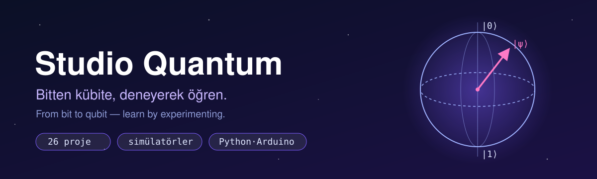

  

<a href="README.md">🇹🇷 Türkçe</a> · <a href="README.en.md">🇬🇧 English</a> · <b>🇩🇪 Deutsch</b> · <a href="README.ru.md">🇷🇺 Русский</a>

  

  
  
  
  
  

---

## ⚛️ Was ist Studio Quantum?

**Studio Quantum** ist eine mehrsprachige Lernplattform, mit der man Quantencomputing praxisnah lernt. Statt auswendig zu lernen, führt sie dich vom klassischen Bit zum Qubit – durch **Experimentieren**.

  

## ✨ Was gibt es?

| | Funktion | Beschreibung |
|---|---|---|
| 🧪 | **26 Quantenprojekte** | Schritt-für-Schritt-Projekte von den Grundlagen bis zu Anwendungen |
| 🖥️ | **Simulatoren im Browser** | Quantensimulatoren, die direkt im Browser laufen – ohne Installation |
| 🐍 | **Python-Labore** | Quantenschaltungen durch eigenen Code erkunden |
| 🔌 | **Arduino-Labore** | Abstrakte Konzepte mit echter Hardware greifbar machen |
| 🤖 | **Lernassistent** | Ein Assistent, der Lernende Schritt für Schritt begleitet |
| 🌍 | **Mehrsprachig** | Inhalte auf Türkisch und Englisch |

## 🎯 Für wen?

- Schülerinnen, Schüler und Studierende, die mit Quantencomputing anfangen
- Lehrkräfte, die praxisnahes Unterrichtsmaterial suchen
- Alle, die Qubits, Superposition und Verschränkung durch Ausprobieren verstehen wollen

## 🚀 Jetzt starten

Keine Installation nötig – Seite öffnen und loslegen:

### 👉 **[studioquantum.org](https://studioquantum.org/)**

<!--
Screenshots im Ordner assets ablegen und die Kommentarzeichen um diesen Block entfernen.

## 📸 Screenshots

  
  

  
  

-->

---

  <a href="https://studioquantum.org/">studioquantum.org</a> · © Studio Quantum

