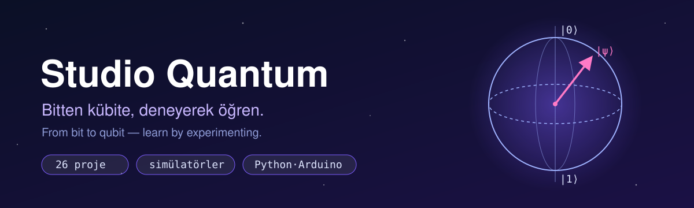

  

<a href="README.md">🇹🇷 Türkçe</a> · <b>🇬🇧 English</b> · <a href="README.de.md">🇩🇪 Deutsch</a> · <a href="README.ru.md">🇷🇺 Русский</a>

  

  
  
  
  
  

---

## ⚛️ What is Studio Quantum?

**Studio Quantum** is a multilingual educational platform for learning quantum computing hands-on. Instead of memorizing, it takes you from the classical bit to the qubit by **experimenting**.

  

## ✨ What's inside?

| | Feature | Description |
|---|---|---|
| 🧪 | **26 quantum projects** | Step-by-step projects from core concepts to applications |
| 🖥️ | **In-browser simulators** | Quantum simulators that run right in your browser — no installation |
| 🐍 | **Python labs** | Explore quantum circuits by writing and running code |
| 🔌 | **Arduino labs** | Make abstract concepts tangible with physical hardware |
| 🤖 | **Guide assistant** | A helper assistant that guides students along the way |
| 🌍 | **Multilingual** | Content in Turkish and English |

## 🎯 Who is it for?

- Students taking their first steps in quantum computing
- Teachers looking for hands-on classroom material
- Anyone who wants to understand qubits, superposition and entanglement by experimenting

## 🚀 Get started

No installation needed — open the site and start experimenting:

### 👉 **[studioquantum.org](https://studioquantum.org/)**

<!--
Add screenshots to the assets folder and remove the comment markers around this block.

## 📸 Screenshots

  
  

  
  

-->

---

  <a href="https://studioquantum.org/">studioquantum.org</a> · © Studio Quantum

