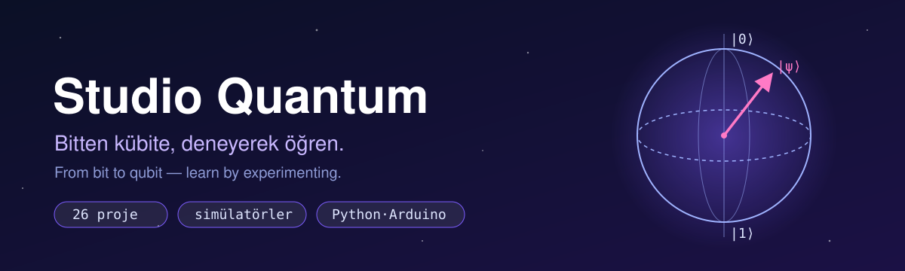

  

<b>🇹🇷 Türkçe</b> · <a href="README.en.md">🇬🇧 English</a> · <a href="README.de.md">🇩🇪 Deutsch</a> · <a href="README.ru.md">🇷🇺 Русский</a>

  

  
  
  
  
  

---

## ⚛️ Studio Quantum nedir?

**Studio Quantum**, kuantum bilişimi uygulamalı olarak öğrenmek için hazırlanmış çok dilli bir eğitim platformudur. Klasik bitten kübite uzanan yolu ezberleyerek değil, **deneyerek** öğretmeyi amaçlar.

  

## ✨ Neler var?

| | Özellik | Açıklama |
|---|---|---|
| 🧪 | **26 kuantum projesi** | Temel kavramlardan uygulamalara adım adım ilerleyen projeler |
| 🖥️ | **Tarayıcıda simülatörler** | Kurulum gerektirmeden, doğrudan tarayıcıda çalışan kuantum simülatörleri |
| 🐍 | **Python laboratuvarları** | Kodla deneyerek kuantum devrelerini keşfetme |
| 🔌 | **Arduino laboratuvarları** | Kavramları fiziksel donanımla somutlaştırma |
| 🤖 | **Rehber asistan** | Öğrencilere yol gösteren yardımcı asistan |
| 🌍 | **Çok dilli** | Türkçe ve İngilizce içerik |

## 🎯 Kimler için?

- Kuantum bilişime yeni başlayan öğrenciler
- Derslerinde uygulamalı materyal arayan öğretmenler
- Kübit, süperpozisyon ve dolanıklık gibi kavramları deneyerek anlamak isteyen herkes

## 🚀 Hemen başla

Hiçbir kurulum gerekmez — siteyi aç ve denemeye başla:

### 👉 **[studioquantum.org](https://studioquantum.org/)**

<!--
Ekran görüntülerini assets klasörüne ekleyip bu bloğun yorum işaretlerini kaldırın.

## 📸 Ekran Görüntüleri

  
  

  
  

-->

---

  <a href="https://studioquantum.org/">studioquantum.org</a> · © Studio Quantum

