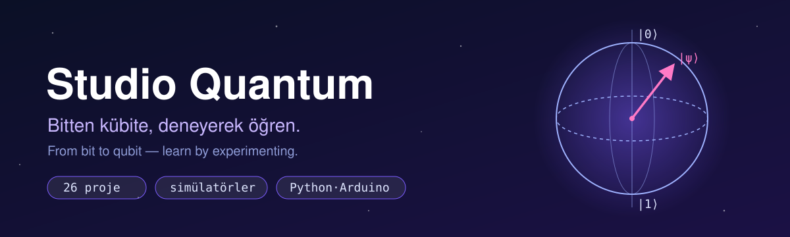

  

<a href="README.md">🇹🇷 Türkçe</a> · <a href="README.en.md">🇬🇧 English</a> · <a href="README.de.md">🇩🇪 Deutsch</a> · <b>🇷🇺 Русский</b>

  

  
  
  
  
  

---

## ⚛️ Что такое Studio Quantum?

**Studio Quantum** — многоязычная образовательная платформа для практического изучения квантовых вычислений. Вместо зубрёжки она ведёт от классического бита к кубиту через **эксперименты**.

  

## ✨ Что внутри?

| | Возможность | Описание |
|---|---|---|
| 🧪 | **26 квантовых проектов** | Пошаговые проекты — от базовых понятий до приложений |
| 🖥️ | **Симуляторы в браузере** | Квантовые симуляторы, работающие прямо в браузере, без установки |
| 🐍 | **Лаборатории на Python** | Изучение квантовых схем через написание и запуск кода |
| 🔌 | **Лаборатории на Arduino** | Абстрактные идеи становятся осязаемыми благодаря реальному «железу» |
| 🤖 | **Ассистент-наставник** | Помощник, который сопровождает учащихся на каждом шаге |
| 🌍 | **Многоязычность** | Материалы на турецком и английском языках |

## 🎯 Для кого?

- Школьники и студенты, начинающие изучать квантовые вычисления
- Преподаватели, которым нужны практические материалы для занятий
- Все, кто хочет понять кубиты, суперпозицию и запутанность на практике

## 🚀 Начать

Ничего устанавливать не нужно — откройте сайт и начните экспериментировать:

### 👉 **[studioquantum.org](https://studioquantum.org/)**

<!--
Добавьте скриншоты в папку assets и удалите символы комментария вокруг этого блока.

## 📸 Скриншоты

  
  

  
  

-->

---

  <a href="https://studioquantum.org/">studioquantum.org</a> · © Studio Quantum

